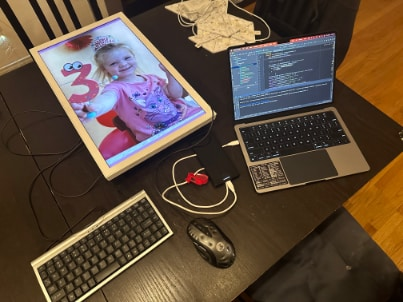
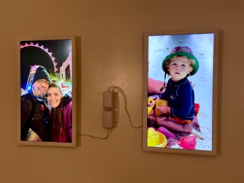
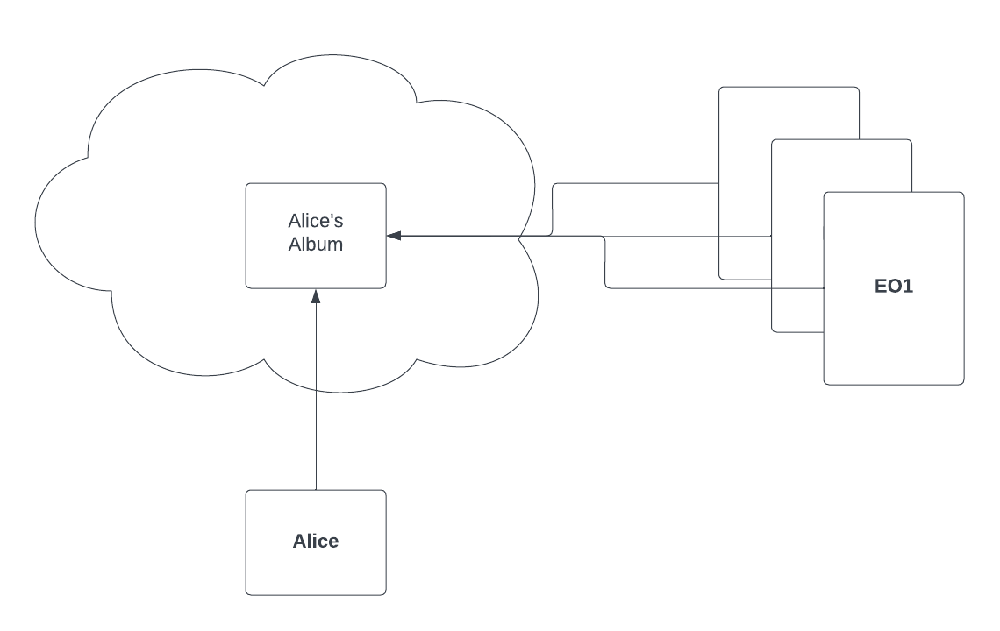
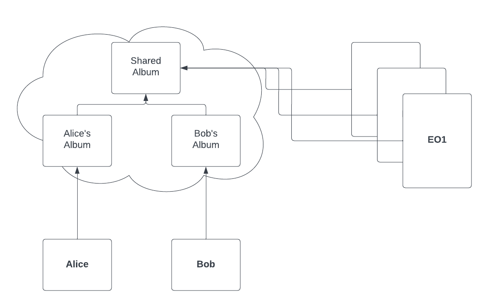

# EO1 and EO2 Replacement APK

Replacement Android software for the Electric Objects **EO1** and **EO2** picture frames, which stops
them depending on a vendor cloud that no longer exists. It is a rewrite of
[spalt/EO1](https://github.com/spalt/EO1).

Where the pictures come from is your choice: files you upload straight to the frame over your own
LAN, an [immich.app](https://immich.app/) server you host, or web pages. All three merge into one
rotation. Nothing in this app contacts a host you did not put into its configuration.

 

This concept guarantees that you control all aspects of the images displayed on your EO1 and/or EO2 and they will never go offline or stop displaying art ever again, because someone else decided to do so!

## Three sources

| Source | What you must have | What appears |
|---|---|---|
| **Files you upload to the frame** | Nothing but the frame and a browser on the same LAN. No server, no account, no password, no TLS — a connected LAN is enough | Every accepted file, straight off the frame's own storage |
| **An Immich server** | Immich **3.x**, and an account's email and password — there is no API key | Everything that account can see, minus trash and archived/hidden |
| **A web page** | A URL something serves | That page, rendered fresh each time it comes up |

> **Uploads do not start working by themselves.** A frame's files only rotate once its configuration
> holds a backend entry of type `local`. Nothing writes that entry for you — not the upload, not a
> reboot — and until it exists, an uploaded file sits safely on disk, lists normally in the page's
> Files table, looks perfectly healthy, and never reaches the screen. The options dialog's
> **"+ Add Local uploads"** button writes it in one tap, and that tap is the entire configuration of
> a serverless frame. [Why it needs hands once](docs/SETUP.md#the-one-step-that-needs-hands).

## Getting pictures on it with no server

Two minutes of this needs a browser; the first step needs the frame in your hands.

1. **Install the APK, once.** How depends on the board: [Setup for EO1](docs/SETUP.md#setup-for-eo1)
   (the ROM's own browser, a keyboard and mouse via OTG) or [Setup for EO2](docs/SETUP.md#setup-for-eo2)
   (`adb install -r`). Everything below needs only a browser.
2. **Power-cycle it.** The app is the HOME replacement, so it takes the screen. On a frame with
   nothing usable configured, the options dialog opens on the **Media** tab by itself — nothing to
   press, nothing to type.
3. **Press "+ Add Local uploads", then Save.** No server, no username, no password, no token.
4. **Read the address off that screen.** The dialog shows a `Wi-Fi IP:` line on every build, with
   nothing to enable. *Optional, and cheapest while you are there:* tick **Trusted Network**, which
   additionally prints the configuration token under it — the one credential that turns the page's
   reads into writes.
5. **Open `http://<frame>/` from any device on the LAN** — if that is refused, `http://<frame>:8080/`.
   No token, no flag, no login. The page header then names the address and port that actually bound.
6. **Select up to 32 photos and press Upload.** They appear in the Files table at once.
7. **They reach the panel within one interval** (minutes; default 5) — or when you press **Next**.
   New files are interleaved into the current cycle's unshown tail, so an upload may not be the very
   next picture.
8. **To replace a photo, Delete the old one first.** Re-uploading a name that is already there lands
   as `name_1.jpg`, and both stay in the rotation.

Uploads survive a self-update (install is `pm install -r`, and `/data` is untouched). A factory
reset, an uninstall, or *Clear data* erases them: they live inside the app's private directory.

## What the frame can show

The frame has no transcoder and resizes nothing — the file that arrives is the file that displays. So
these limits are yours to hit, and they appear in no other document:

| | Accepted | Recognised and then refused |
|---|---|---|
| **Stills** | `jpg` `jpeg` `png` `gif` `webp` `bmp` `dng` | `heic` `heif` `avif` — named HEIF/AVIF stills, undecodable here |
| **Video** | `mp4` `mov` `m4v` `mkv` `avi` `ts` `webm` `3gp` `mpg` `mpeg` | `h265` `hevc` `av1` — the extension names the codec itself |

A `.mov` or `.mp4` is a container, not a verdict: once it is on disk the sample description decides,
which is what catches the everyday iPhone file. That is deliberate — a name that *could* hold a bad
codec is never treated as proof that it does.

**Encode targets.** JPEG or PNG for a still. For video: H.264 in `mp4`/`mov`/`m4v`, longest side
**at most 1920 px**, and **1080p30 or below**. The decoder's real ceiling is sustained throughput,
300 000 macroblocks a second: 1080p29.97 is 244 555 and plays at 1.00x, while 1080p59.94 is 489 343
and runs at **0.13x** — slow motion, forever, with no error raised. 720p60 fits where 1080p60 does
not. Files above 1 GiB are never fetched.

Three things people get wrong:

- A still is **center-cropped to fill** a portrait 1080x1920 panel, never letterboxed. Compose for that.
- A video holds the whole interval and loops inside it, **muted** — and an EO1 has no audio output at all.
- An upload cap you exceed lands **zero** files, not a partial batch: 32 files, 512 MB each, 2 GB per
  request. Everything is parsed into a staging area before any file is renamed.

And the consequence of having no server behind you: an uploaded clip is never routed to a lighter
copy, because there is no fallback source to route *to*. A file that is merely too heavy displays in
slow motion and nothing marks it as incompatible. With Immich that same file would be re-fetched as a
server transcode.

## When a photo doesn't show up

1. In the page's Files table, look for **`<name>.incompat.txt`** beside the file that never appeared,
   and open it. It carries the file's size and dimensions, the exact reason, a fix instruction, and a
   JSON block naming the model, Android version and app build — everything needed to file a bug
   report without going near the frame.
2. Apply its fix (JPEG or PNG; H.264 in MP4, long side ≤ 1920 px) and re-upload.
3. Or just **delete the `.txt`** — the frame re-checks the file on the next tick. Writing one by hand
   is a supported way to bench a file or keep it out of the rotation.

Two cases a report cannot cover, stated rather than papered over: a clip that is merely too heavy
gets no report at all (see above), and a file that fails *while being displayed* — as opposed to
being rejected when scanned — writes nothing and is retried every cycle. Marking it incompatible is a
no-op for a local file, so there is no tag to look for; the `flagged … in backend 'local'` line that
gets written anyway describes a tag that was never made, and it lands in logcat only — the ~13-minute
buffer, not `/logs`.

A report appears within a tick of the file's first scan, not the instant you upload. The minute after
an upload is too early to conclude it is broken.

## Which frame is this?

| | EO1 | EO2 | What it means |
|---|---|---|---|
| Soft-touch buttons | Two (top toggles the screen, BACK steps brightness; both within 250 ms checks for updates) | None | On an EO2 every one of those is a button on the web page |
| Light sensor | Yes | No | EO1's brightness floor rides ambient lux; on EO2 the floor *is* the brightness |
| TCP adb | Not configured — connecting gives `ECONNREFUSED` | Listens on 5555 from boot, unauthenticated | Silent updates work unattended on EO2; on EO1 only if you opt in twice. On EO2 that exposure is the shipped state |
| Web page port | 80, else 8080 | 8080 | The page header and `/state` say which won |
| Installing | Browser sideload over OTG | `adb install -r` | [Setup](docs/SETUP.md) |
| Touchscreen | No | No | A pointer appears in exactly one step, ever |

The board is detected from `Build.DEVICE`/`Build.MODEL`, and all of it sits behind
`HardwareCapabilities` flags. Reachable but not in front of you? `GET /state`'s `capabilities` block
answers `lightSensor`, `screenBrightness`, `brightnessButton` and `powerButton` without anyone
walking to the wall. Evidence for the whole table is in
[docs/EO2-CAPABILITIES.md](docs/EO2-CAPABILITIES.md).

## Day to day

**Rotation.** The merged pool is shuffled once and consumed **in order**, so every asset shows exactly
once per cycle; at the end of a pass the catalogs are re-fetched and the pool re-shuffled. It is not
random per tick — a photo cannot come up twice while the rest of the shelf waits, and that holds even
for a library where the same picture is listed by two different queries. The `interval` is in
**minutes**, defaults to
**5**, and is clamped to at least 1. The next asset is prefetched right after each display, so a
rotation is normally a cache hit and dwell time never waits on a download. Uploaded files **join** on
the next tick, with no restart. **Deleting** is different: the tick that noticed deletions only ever
*adds*, so the removed file stays a record in the current pass until the next pool rebuild, at the end
of the cycle. When its turn comes the frame finds no bytes, logs the failure, and moves straight on to
the next asset — a gap in the pass, never a blank panel.

**Quiet hours.** `quietHours` is a list of 5-field cron expressions (`minute hour day month weekday`);
the screen is off whenever **any** expression matches the current minute in `selectedTimeZoneId`, so
overlapping windows simply OR. `* 22-23,0-6 * * *` = off every night 22:00–06:59; `0 13 * * 1-5` = off
weekdays at 13:00. While the panel is off the rotation does not advance, so a frame wakes on the
*next* asset in the pass — not the one that would have shown at 03:00.

**Brightness.** Eight steps from 0.3 to 1.0, held as a per-device step index in the app's own
preferences — never in `configuration.json`, never exported. On an EO1 that index is a **floor** the
light sensor lifts toward 1.0 between 0.175 and 150 lux; on an EO2 the floor *is* the brightness, and
the page's **Brightness** action is the only control that frame has. BACK steps it on EO1, and its
wrap from the top back down to 0.3 is intentional — it is how a frame comes back down.

| From a keyboard (EO1) | From the web page (either board) |
|---|---|
| `C` options · `SPACE` screen · `S` next · `U` check updates · `F2`/`F4` | **Next** · **Screen** · **Brightness** · **Check updates** · **Install on the frame** · **Update reset** |

### The MQTT tab

The options dialog's second tab is real, and is named in no other document. Pointing it at a broker
makes the frame subscribe to `sonos/+` and paint a now-playing banner — track title, artist, group
name — over the current picture for the track's duration, then fade it. It is a display overlay, not
a control plane: no MQTT message rotates, installs, reconfigures or wakes anything, and nothing
outside the banner reads the payload. It is inherited from a Sonos experiment the upstream project
began, and it stays completely inert until you name a broker.

## The frame's web page

Every frame runs one, from the first launch, with no setting that turns it off. It listens on port
**80** and falls back to **8080** when binding fails — which it does for a sideloaded install, where
the low port answers `EACCES` — and both its own header and `/state`'s `app.webPort` report which one
won. It is plain HTTP with no login, reachable by anything on the LAN: **treat the network as the
perimeter.** Every file it hands out arrives as a download, because the frame's screen is the gallery
and the page is the loading dock.

| Needs | Routes |
|---|---|
| Nothing | upload, files, delete, control (next/screen/brightness/config), state, logs, crashes, reports, *Capture now*, health |
| *Trusted Network* **+** the per-device token | `/config`, config download and import, `POST /update`, `POST /devicename` |
| Debug builds only | `keyevent`, `watchdog`, `action=show` |

Two seams worth knowing before you need the page: the configuration **token** is readable in exactly
one place — the dialog's Media tab, and only while the flag is *already* on — and that flag has no
browser route at all, since the options dialog is its only writer. So **adding a second source or
changing the interval is the one thing that still needs hands.** Everything else, including deleting
a photo, does not. And note the asymmetry: deleting a crash *report* enforces a same-origin check,
while deleting a *photo* enforces nothing.

The full route-by-route reference is [docs/WEBSERVER.md](docs/WEBSERVER.md).

## Multiple media backends

The frame's configuration holds a list of **media backends**; the rotation pool merges the catalogs of
all of them into one shuffled pass. Any number of Immich hosts is allowed, plus one optional **local**
backend for files uploaded through the frame's [LAN web server](docs/WEBSERVER.md) — it joins the
rotation as an equal peer and needs no account — plus any number of **web** backends, each showing one
web page.

Template: [`configuration_example.json`](configuration_example.json).

```json
{
  "selectedTimeZoneId": "America/Los_Angeles",
  "quietHours": ["* 22-23,0-6 * * *"],
  "interval": 5,
  "backends": [
    { "type": "local", "id": "local" },
    { "type": "immich", "id": "immich-1", "host": "http://immich.local/", "userid": "frame1@example.com", "password": "secret", "apiVersion": "auto" },
    { "type": "immich", "id": "immich-2", "host": "https://other.example.com:3001/", "userid": "frame2@example.com", "password": "secret", "apiVersion": "3.1.0" },
    { "type": "web", "id": "web-1", "host": "http://192.168.1.20/dashboard/" }
  ]
}
```

- **Local backend** — optional, at most one (`"type": "local"`), and it is always valid with no host,
  user or password. **Its existence is what turns uploads on**: files uploaded through the web server
  appear in the rotation on the next interval tick, no restart — while a *deleted* file stays in the
  current pass until the pool is rebuilt at the end of the cycle. Unlike
  an Immich asset, an uploaded file that fails the compatibility check is *removed from the pool* by
  its sidecar report rather than merely tagged for a human — the exclusion is stronger, and it is the
  one door back in.
- **Enabled** — every row carries an `enabled` flag, default true, and an absent key means true, so a
  config written before the flag existed keeps its backends running. A backend switched off costs only
  its own assets, and the entry stays in the document, so switching it back is a checkbox rather than
  an edit. The page's config editor renders one for `immich` and `web` rows and **none** for the local
  row — the entry's existence is that row's switch — though a hand-written `"enabled": false` on a
  local entry is still honored.
- **`apiVersion`** — per backend, so one frame can point at servers of different vintages. `"auto"` (the default) probes the server's version on first contact and uses the matching client; a pinned semver like `"3.1.0"` skips the probe and selects the client for that band (the current band is **all of 3.x**). A version newer than the band is served best effort by the newest client with a compatibility toast; only a version older than every band — or a backend that genuinely fails — disables just that backend, while the others keep rotating.
- **Website backend** — `"type": "web"`, **one entry per page**, `host` holds that page's address used exactly as written (no trailing `/` is appended), and nothing else is needed — no account. What that engine can actually render, and how a dead page is abandoned, is [its own section](#show-a-web-page-limited).
- **Quiet hours** — a list of 5-field cron expressions, evaluated in `selectedTimeZoneId`; the matching rules and examples are under [Day to day](#day-to-day). Old `startQuietHour`/`endQuietHour` values are migrated to the equivalent expression on load; a single whole-hour window is mirrored back into those fields on save so older APKs keep working.
- **Legacy configs** — an old file with flat `host`/`userid`/`password` is migrated on load to a single `immich-1` backend and rewritten on disk; the flat fields are kept mirrored on save so older APK versions can still read the file.
- **Editing** — three routes: the options dialog's Media tab, which opens by itself on a frame with no
  valid backend (or on `C` on a connected keyboard); the **config** action on the page from any
  browser, which raises that same dialog on the frame's screen — though operating it still needs a
  pointer, and the page's own config editor needs *Trusted Network*, which has no browser route; or
  editing `configuration.json` directly, which on an EO2 is a `adb push` and a reboot.
- If a backend's server is unreachable or a credential is wrong, that backend is skipped for the cycle and the rest keep rotating. A web page that fails to load is abandoned the same way: the frame shows the next asset in the pool instead of a blank panel and retries the page on its next turn.

## Add an Immich server (optional)

Uploads need nothing, so this section only exists because a server buys three things a frame holding
its own files cannot: a phone app that pushes into a library you already maintain, one source feeding
several frames at once, and a server that can transcode for you.

- **Server** — Immich **3.x** — anything from **3.0.0** up to **4.0.0** (endpoints verified against the **3.3.3** OpenAPI spec). Immich's HTTP API does change between major releases: a server newer than anything this build knows is still tried, with a one-off compatibility toast, and the photos rotate if it works. A server older than 3.0.0 is skipped with a toast, since its API predates this app.
- **Login** — the configured **email and password**, and nothing else: there is no API-key field
  anywhere in the model, and an entry without both is invalid. Keep in mind that this password is
  stored in clear-text on the frame. Everyone with access to your device can recover the password!
  The pair is spent once at the login endpoint and the token it returns rides on everything after, so
  rotating the password and typing the new one into the config takes effect on the next tick with no
  reboot. A failed login cools down for 60 seconds rather than retrying.
- **Scoping is a limit, not a setting.** No album, tag or favourite filter exists: the pool is every
  asset in every album the account owns or is shared into, plus the whole visible timeline, minus
  trash and archived/hidden. So **a per-frame account fed by shared albums is the only way to aim a
  frame at particular pictures.**
- **Many frames, many hosts.** `apiVersion` is per entry, one frame can mix server vintages, and a
  dead backend costs only its own assets.

### Managing multiple frames with Immich

In a situation where you will want to manage multiple EO2s (or when you want to have granular control on what a single EO2 displays) you'll want to create an immich account for **each EO**. These accounts should be separate from your master (admin) account that manages the immich instance. In the immich Administration area, click the "Create User" button and name it for the EO2 (eg EO2-LivingRoom). _at the point of writing this, each account requires a separate email address, however in my testing this address is not used and does not need to be verified. If this changes in future versions of immich, you'll have to provide unique emails for each EO._ Use the created email/password combo for each EO2 as that device's `immich` backend entry in its `configuration.json` (one backend per device is the typical setup; extra backends can be added in the file or the options dialog). Create separate albums for your pictures — either organized as previously on the electricobjects website (each album is a playlist) or create albums specific for each device. Choose the album you want to show on each device, click the Share icon in the up-right of the immich app, and choose the account associated with the device. The app will only be able to see content from your immich database that is shared with it.

 

Then give each frame a name, so you can tell them apart without a DHCP lease: the options dialog's
**About** tab has a *Device name* field, and so does the frame's own web page (`POST /devicename`,
once *Trusted Network* is on). The label is stored on the device and never in `configuration.json`, so
it cannot be copied to another frame by an import — it appears in the frame's debug overlay and in the
web page header, which is what makes `http://192.168.1.87:8080` announce itself as the kitchen. A frame
with no name still says where it is: the options dialog's first tab prints its Wi-Fi address on every
build, so no router's DHCP table is needed to find one you have never configured.

> **Why an album's pictures are not privileged.** Immich answers a catalog with the album listings
> *and* the whole timeline, so a shared picture is named twice in one response. The rotation pool
> dedupes by asset key, so each one still takes exactly **one** slot in the pass — being filed in an
> album changes what the frame is allowed to see, never how often it shows. Two frames of the same
> photo from two different *hosts* are two assets, and both stay.

### When an Immich backend misbehaves

| What you see | What it means |
|---|---|
| A compatibility toast naming a version | The server is newer than every band this build knows. It is served best effort by the newest client and keeps trying — this is a notice, not a failure |
| A login failure in `/logs` | Bad credential or unreachable host; that backend is skipped and retries after a 60-second cooldown, while the others keep rotating |
| An asset tagged `EO1_INCOMPATIBLE` in your library | The frame tried everything it had and could not display it. The tag is **write-only**: the app never reads it back as a filter and re-tags an already-tagged asset, so a fixed asset needs no app-side unfreezing — and a stale tag cannot retire one that works. For video, what usually fixed it is the server's transcoding settings, not the frame |

HTTPS against that server is a separate problem with its own answer: the ROM's certificate store dates
from about 2013, and the app adds current roots to it for its own connections — see
[docs/TRUST.md](docs/TRUST.md). The server does **not** have to weaken itself: TLS 1.2 is enabled on
the frame side, forward secrecy is kept, and what remains is a matter of which gate your host trips.

## Show a web page (limited)

The least first-class source there is, because a page needs a server by definition. One entry is one
page is one asset in the pool — so with 300 photos and 2 pages, each page shows about once every 150
intervals — and it holds the screen for a whole `interval`.

A web asset has no bytes: it is never downloaded, cached, integrity-checked or codec-checked, and it
is fetched fresh every time it comes up, which is the point. The engine is Android 4.4's Chromium 33,
with JavaScript and DOM storage on, local-file and content access off, `alert`/`confirm`/`prompt`
auto-cancelled so an unattended frame never waits on a dialog nobody can dismiss, and any
`market:`/`tel:`/`intent:`/`mailto:` link swallowed rather than ejecting the frame from HOME. Plan on
LAN dashboards and deliberately legacy pages, not modern SPAs.

An `https://` page depends on the ROM's 2013 store: the shipped root bundle does **not** reach this
browser, because Chromium validates inside its own engine and ignores any Java trust manager. No app
update changes that.

When a page errors, or paints nothing for 30 seconds, the photo underneath is revealed and the pool
moves on — at most 3 dead pages are walked per cycle, so a server that is down cannot stall a frame.

## Living with it

**It recovers itself.** A watchdog runs on its own timer — off the main thread, because the main
thread is one of the things it watches — and climbs one rung per wedge:

1. force a rotation
2. tear the player down and redraw
3. repair Wi-Fi
4. restart the app
5. reboot the device — **only with your permission** (the `autoReboot` checkbox, off by default; the four rungs above are unaffected by it)

It starts watching after the larger of 20 minutes and three intervals, and a reboot rung that reboots
nothing still writes a report first.

**It leaves evidence.** `/crashes`, `/reports`, and the page's **Capture now** button are deliberately
ungated, because the frame you need a report from is the frame whose screen you cannot reach (one
capture per 30 seconds; reports kept 30 days and 8 MB, crashes 14 days and 4 MB). `logcat` holds about
13 minutes on these devices, so the app's own rolling log file and those two stores are what survives
to the next morning.

**TLS, in four sentences.** The ROM's certificate store dates from about 2013 — 156 anchors measured
on a live EO2, 63 of them past their own expiry, and none of them Let's Encrypt's — so a modern
certificate was once simply unvalidatable. The app enables TLS 1.2 itself and merges current public
roots into its own connections, and merging may only ever *add*: a narrowed set would break hosts that
work today. Four gates decide whether a connection succeeds — anchors, cipher suites, the server's own
cipher policy, and a device clock this app never syncs — and a frame that cannot connect now says
which one: its backend record and its update error string carry a `[TLS gate: …]` note, and carry no
note at all when the failure was never about certificates. [docs/TRUST.md](docs/TRUST.md) explains the
four. A frame whose only source is its own uploads consults no certificate at all.

**Keeping it current.** The frame can update itself: manifest over plain HTTP, four verification gates,
headless install, and a forward-only rule that never downgrades or uninstalls. That is a chapter of its
own — [docs/UPDATING.md](docs/UPDATING.md).

## What this will not do

- **Android 4.4 / API 19 is a product constraint, not laziness.** Java only, no Kotlin, and the
  dependency pins exist for that SDK. The browser inside it is Chromium 33.
- **About 800 MB of usable storage, and nothing is transcoded or resized on the device.** There is no
  on-device FFmpeg. The per-file ceiling is the smaller of 1 GiB and your free space.
- **Video:** 1080p30 is the practical ceiling; HEVC, AV1, VVC, Dolby-Vision, and every HEIF or AVIF
  still never decode. ExoPlayer and Media3 are forbidden here — they hang this SoC's media stack until
  a power cycle, which is why playback runs on Amlogic's TsPlayer with a `MediaPlayer` fallback.
- **Files you upload live inside the app.** A factory reset, an uninstall or *Clear data* erases them.
  Every one can also be downloaded back off the frame through the files route, if you want a second copy.
- **The LAN server is unsecured plain HTTP with no login, by design.** Anything about this frame is
  visible to the whole subnet. Config routes, APK upload and the device name sit behind the flag and
  token; file deletes are the one write route with no same-origin check. On an EO2, TCP adb is open on
  port 5555 as root in the shipped ROM, and no setting in this app turns that off.
- **An Immich password sits in cleartext in `configuration.json`.** There is no API-key alternative.
- **No server is not the same as no network.** Rotation needs a connected link (API 19's `isConnected`
  — there is no reachability probe), so a LAN-only Wi-Fi network is enough and a dead one is not.

## Building

```bash
git lfs pull          # the Amlogic TsPlayer native library
./gradlew assembleDebug
./gradlew test
```

Modern Android Studio no longer supports the Gradle/SDK pins this project needs for IDE debugging. Use:

```bash
./debug.sh
```

That builds the debug APK (armeabi-v7a carries the Amlogic TsPlayer `.so`; arm64-v8a is a native-lib-free emulator fallback), creates or reuses an AVD named `EO1` (API 19) constrained like the real hardware, installs and launches the app, then attaches to logcat. Press **Ctrl+C** to stop and quit the emulator.

On **Apple Silicon**, API 19 images generally cannot boot, and 32-bit ARM emulators are unsupported. After API 19 fails, the script falls back to AVD `EO1_API21` (`system-images;android-21;default;arm64-v8a`). The committed LFS TsPlayer `.so` is **armeabi-v7a** only (EO1 hardware); the arm64-v8a fallback has no native player, so the app falls back to `MediaPlayer` there. That path is an approximation for development, not EO1 fidelity. Debug APKs omit `maxSdk` so they can install on the fallback AVD; **release** builds still use `maxSdk 19` and armeabi-v7a only for real devices.

Releases are built and signed locally — there is no CI. See
[Publishing a new version](docs/UPDATING.md#publishing-a-new-version-operator-side).

## History

This repository began as a rewrite of [spalt/EO1](https://github.com/spalt/EO1), whose author started
from the same premise that keeps this one alive: an Electric Objects frame stopped displaying because
someone, somewhere, decided to stop the service behind it. Immich was the first source built, because
it was the answer to "where do the pictures come from now" for the people who had already left the
vendor cloud — and it stays a good one, especially for a library you already maintain on a phone. It is
no longer the premise. The frame carrying its own files is.

## Further Reading

1. [Installing the APK](docs/SETUP.md) — EO1 and EO2 bootstrap, and writing config by hand
1. [Updating a frame](docs/UPDATING.md) — self-update, verification, recovery, publishing
1. [The frame's web server](docs/WEBSERVER.md) — every route, and what gates it
1. [TLS trust and the 2013 CA store](docs/TRUST.md) — why a modern certificate failed, and what fixed it
1. [TsPlayer and Amlogic video](docs/TSPLAYER.md) — playback, the failure ladder, the watchdogs
1. [EO2 capabilities investigation](docs/EO2-CAPABILITIES.md) — the evidence behind the parity table
1. [EO1 Hardware specifications](EO1-specs.md)
1. [AGENTS.md](AGENTS.md) — repository map for AI coding agents

## Contribution

1. You can provide feedback by opening [Issues](https://github.com/aphex3k/EO1/issues) and describing an idea or problem.
1. You can donate in Dollar via [PayPal](https://www.paypal.me/aphex3k) or in [Bitcoin](https://getalby.com/p/michaelhenke).
1. If you happen to have a working but no longer needed EO1/EO2 picture frame, please reach out via email!
